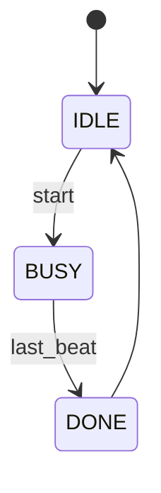

# DV Interview Questions

A curated, searchable collection of **Design Verification (DV)** job interview questions,
each with a clearly written question and a full, readable solution — including diagrams,
waveforms and figures where they help.

The goal is a convenient web interface for browsing and practicing the questions,
filtered by **position level** and **difficulty**.

> **Status:** early stage. The repository structure and conventions are defined below;
> the web interface is not built yet. See [`HANDOFF.md`](HANDOFF.md) for the task list,
> progress and next steps.

---

## How questions are organized

Every question is classified along two independent axes, plus free-form topic tags.

### 1. Position level

| Level       | Folder                | Typical expectations                                                      |
|-------------|-----------------------|---------------------------------------------------------------------------|
| Student     | `questions/student/`  | Digital logic fundamentals, basic HDL, logic puzzles, basic programming   |
| Junior      | `questions/junior/`   | SystemVerilog, basic UVM, writing tests and checkers, simple protocols    |
| Senior      | `questions/senior/`   | Testbench architecture, advanced UVM, SVA, coverage closure, debugging    |
| Staff       | `questions/staff/`    | Verification strategy and planning, methodology, scaling, leading a team  |

### 2. Difficulty (within a level)

| Difficulty | Badge | Meaning                                                                 |
|------------|-------|-------------------------------------------------------------------------|
| Easy       | 🟢    | Direct knowledge question, short answer                                 |
| Medium     | 🟡    | Requires reasoning or a small design / code snippet                     |
| Hard       | 🔴    | Multi-step problem, trade-offs, or a non-trivial design / debug scenario |

Difficulty is **relative to the position level** — a "Hard" student question may be an
"Easy" senior question.

### 3. Topic tags

Each question carries one or more tags, for example:
`digital-logic`, `systemverilog`, `uvm`, `sva`, `coverage`, `protocols`, `fifo`,
`clock-domain-crossing`, `computer-architecture`, `scripting`, `c-cpp`, `puzzles`,
`methodology`, `behavioral`.

---

## Repository layout (planned)

```text
DV-Interview-Questions/
├── README.md            # This file
├── HANDOFF.md           # Task list: done / in progress / future work
├── questions/
│   ├── student/
│   ├── junior/
│   ├── senior/
│   └── staff/
│       └── 0001-example-question.md
└── assets/
    └── images/          # Figures and screenshots referenced by questions
```

Files are named `<id>-<short-slug>.md`, where `<id>` is a zero-padded running number that
is unique across the whole repository (e.g. `0007-async-fifo-depth.md`).

---

## Question format

Each question is a single Markdown file with a metadata header (front matter) followed by
the question, an optional hints section, and the solution.

````markdown
---
id: 0007
title: Asynchronous FIFO depth calculation
level: junior            # student | junior | senior | staff
difficulty: medium       # easy | medium | hard
tags: [fifo, clock-domain-crossing, digital-logic]
source: ""               # optional: company / interview round, if you want to keep it
added: 2026-10-15
---

## Question

Clear, self-contained problem statement. Includes all assumptions and constraints.

## Hints (optional)

<details>
<summary>Hint 1</summary>

A nudge in the right direction without giving away the answer.

</details>

## Solution

Step-by-step explanation, written so that the reasoning — not just the final answer —
is clear.

## Key takeaways

- The concepts the interviewer is actually checking.
- Common mistakes and follow-up questions to expect.
````

### Diagrams and figures

| Kind of figure                  | How it is written                                             |
|---------------------------------|---------------------------------------------------------------|
| Block diagrams, flows, FSMs     | [Mermaid](https://mermaid.js.org/) code blocks                |
| Timing diagrams / waveforms     | [WaveDrom](https://wavedrom.com/) JSON                        |
| Code                            | Fenced blocks with a language (`systemverilog`, `python`, …)  |
| Hand-drawn sketches, screenshots| Image files under `assets/images/`, referenced by relative path |

Example (Mermaid FSM):



---

## Adding a new question

1. Pick the position level and difficulty.
2. Take the next free `id` (see the highest existing id in `questions/`).
3. Create `questions/<level>/<id>-<slug>.md` using the format above.
4. Put any images in `assets/images/` and reference them with a relative path.
5. Commit with a message like `Add question 0007: Asynchronous FIFO depth calculation`.

---

## Web interface

Planned features (details and decisions are tracked in [`HANDOFF.md`](HANDOFF.md)):

- Browse questions by position level, difficulty and tag
- Full-text search
- Rendered diagrams (Mermaid, WaveDrom) and syntax-highlighted code
- Solutions hidden by default, revealed on click — for self-practice
- Hosted for free on GitHub Pages and rebuilt automatically on every push
