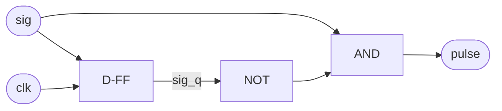

## השאלה

נתון אות `sig` שמסונכרן לשעון `clk`. תכנן מעגל שמוציא במוצא `pulse` פולס ברוחב
**מחזור שעון אחד בדיוק** בכל פעם ש-`sig` עובר מ-`0` ל-`1` (עליית שפה).

יש לשרטט את המעגל, לכתוב אותו ב-SystemVerilog ולצייר דיאגרמת תזמון.

??? tip "רמז"
    כדי לזהות *שינוי* צריך להשוות בין הערך הנוכחי של האות לבין הערך שלו במחזור הקודם.
    איזה רכיב זוכר ערך של מחזור אחד אחורה?

## הפתרון

### הרעיון

שומרים את הערך של `sig` מהמחזור הקודם ב-Flip-Flop אחד, ונקרא לו `sig_q`.
עליית שפה מתרחשת בדיוק כאשר הערך הנוכחי הוא `1` והערך הקודם היה `0`:

\[
pulse = sig \land \lnot sig\_q
\]

### המעגל



### מימוש ב-SystemVerilog

```systemverilog
module rise_detect (
  input  logic clk,
  input  logic rst_n,
  input  logic sig,
  output logic pulse
);
  logic sig_q;

  always_ff @(posedge clk or negedge rst_n)
    if (!rst_n) sig_q <= 1'b0;
    else        sig_q <= sig;

  assign pulse = sig & ~sig_q;
endmodule
```

### דיאגרמת תזמון

```wavedrom
{ signal: [
  { name: "clk",   wave: "p........." },
  { name: "sig",   wave: "0.1...0.1." },
  { name: "sig_q", wave: "0..1...0.1" },
  { name: "pulse", wave: "0.10....10" }
]}
```

הפולס עולה באותו מחזור שבו `sig` עולה, ויורד במחזור הבא, כאשר `sig_q` כבר "תפס" את הערך `1`.

## נקודות חשובות ושאלות המשך

- **ירידת שפה:** מחליפים את התנאי ל-`~sig & sig_q`.
- **שתי השפות:** משתמשים ב-`sig ^ sig_q` (XOR).
- **אות אסינכרוני:** אם `sig` מגיע מדומיין שעון אחר, קודם מעבירים אותו דרך סנכרון של שני
  Flip-Flops (2-FF synchronizer), ורק אחר כך מבצעים את זיהוי השפה על האות המסונכרן.
- **מוצא רשום:** המוצא כאן קומבינטורי. אם רוצים מוצא נקי ישירות מ-Flip-Flop, אפשר לרשום
  גם את `pulse`, במחיר השהיה של מחזור אחד.
